<p align="center">
  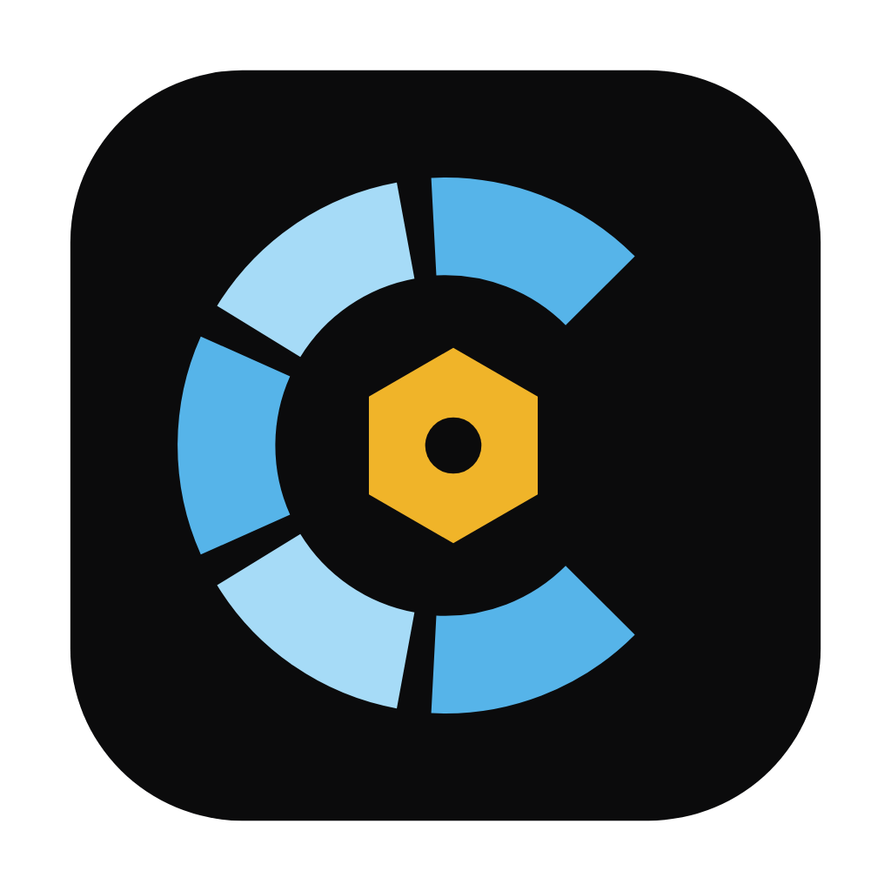
</p>

<h1 align="center">Cordon</h1>

<p align="center">
  <b>One browser for every client. Nothing crosses between them.</b><br>
  A secure, multi-tenant browser built for MSP technicians.
</p>

<p align="center">
  <a href="https://github.com/d1same/cordon/releases/latest"></a>
  
  
  
</p>

<p align="center">
  <a href="https://github.com/d1same/cordon/releases/latest"><b>Download</b></a>
  &nbsp;·&nbsp; <a href="#install">Install</a>
  &nbsp;·&nbsp; <a href="#features">Features</a>
  &nbsp;·&nbsp; <a href="#how-to">How-to</a>
  &nbsp;·&nbsp; <a href="#security">Security</a>
  &nbsp;·&nbsp; <a href="#faq">FAQ</a>
</p>

<p align="center">
  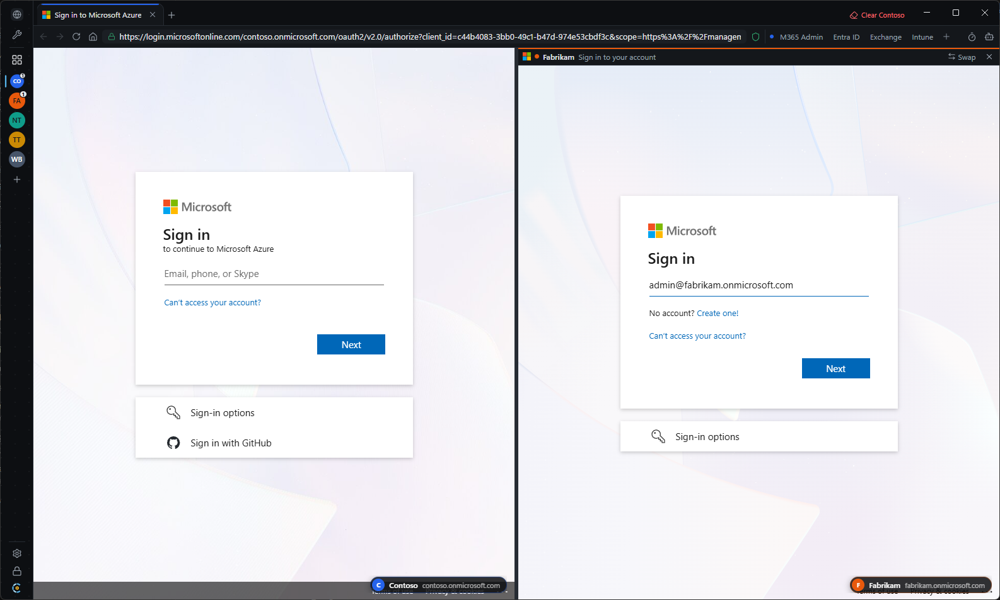
</p>
<p align="center"><sub>Two clients side by side, each in its own sealed session. All screenshots use made-up sample clients (Contoso, Fabrikam, Northwind…).</sub></p>

---

## Why Cordon

MSP technicians sign into dozens of client tenants a day. In a normal browser that means juggling profiles, private windows and the constant risk of making a change in the wrong tenant. Cordon gives every client its own sealed session and labels every page with the client it belongs to.

| | Normal browser | Cordon |
|---|---|---|
| Signed into many clients at once | Separate profiles or private windows | Built in: one sealed session per client |
| Which tenant am I in? | Read the address bar and hope | Colored badge on every page, plus a wrong-tenant warning |
| Client cookies and sign-ins | Shared across tabs in a profile | Never cross between clients |
| MSP tools (Halo, IT Glue, RMM…) | Bookmarks | One-click sidebar, shared or separate sign-ins |
| Updates | Trust the download | Checked against Cordon's own offline signature |

## Features

### Client isolation
- **A sealed session for every client.** Be signed into Contoso's and Fabrikam's Microsoft 365, Google and Adobe admin portals at the same time. Cookies, storage and sign-ins never mix.
- **Client badge on every page.** A name and domain badge shows whose tenant you're in, even in a screen share.
- **Wrong-tenant warning.** A red bar when a client's tab signs into a different Microsoft tenant, and an amber bar when the sign-in name or domain doesn't match.
- **Clear one client** or **wipe everything** in one click.

### Find anything fast
- **Home: all clients.** Every client on one page. Type to filter, or type an address or search.
- **Client Home.** Each client's portal shortcuts (M365 Admin, Entra ID, Intune…) and recent pages. Remove one recent page, or clear them all.
- **Quick switcher.** <kbd>Ctrl</kbd>+<kbd>K</kbd> finds any client, tool, open tab or shortcut.
- **Reopen a closed tab** with <kbd>Ctrl</kbd>+<kbd>Shift</kbd>+<kbd>T</kbd>.

### Work side by side
- **Split view.** Two tabs next to each other, even from different clients. Drag the divider, swap sides with one click.
- **App windows.** Drag a tab out of the window and it becomes its own app window, page only. Or install any tool as an app with its own taskbar icon.
- **Combined tools.** Put 2–4 tools (say NinjaOne + Huntress) behind one sidebar button.

### Your MSP tools
- Halo, ConnectWise, Autotask, IT Glue, Hudu, N-sight, N-central, NinjaOne, Datto RMM, Huntress, Duo, SentinelOne, Cove, CIPP, or any https tool you add. Tool icons are found automatically.
- **Shared or separate sign-ins.** *Shared* signs you in once for all your everyday tools. *Separate* gives every tool its own session. Any single tool can have its own session (right-click it → **Own session**).

### Password managers
- **Your extension, inside Cordon.** Use the **Bitwarden**, **1Password** or **LastPass** extension you already have in Chrome or Edge. It fills logins in your tool pages, including SSO and self-hosted servers. It never runs in client tabs.
- **Vault side panel.** Your web vault next to the page (<kbd>Ctrl</kbd>+<kbd>Shift</kbd>+<kbd>B</kbd>): Bitwarden, Bitwarden EU, 1Password, LastPass or your company's own server. It locks when Cordon locks.

### Built-in add-ons
No extensions to install, and nothing runs inside web pages.

<table>
  <tr>
    <td width="50%">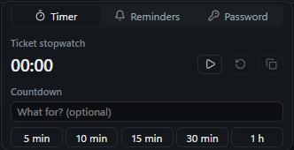</td>
    <td width="50%">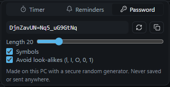</td>
  </tr>
  <tr>
    <td><b>Timer.</b> A ticket stopwatch (Copy gives a time entry like <code>0.25 h</code>) and a countdown with a notification.</td>
    <td><b>Password generator.</b> Strong random passwords, made on your PC and never saved.</td>
  </tr>
</table>

- **Reminders.** "Call back Contoso in 30 min." A Windows notification when it's due. While Cordon is locked, the reminder text stays hidden.
- **Full-page screenshot.** <kbd>Ctrl</kbd>+<kbd>Shift</kbd>+<kbd>S</kbd> captures the whole page, not just what's on screen. Save it as a PNG or copy it.

### Everyday browsing
- **Click to call or email.** Phone and email links on any page, including inside embedded emails in Halo, open Teams, Zoom or your mail app. When a page starts a call by itself, Cordon asks first and names the site.
- **AI side panel.** Microsoft 365 Copilot, ChatGPT, Claude or Gemini, with its own sign-in, separate from every client.
- **Ad and tracker blocking** in every session. Pause it per site with the shield in the address bar.
- **Your search engine:** DuckDuckGo, Google, Brave or Bing. Searches open in the separate **Web** group, never inside a client's session.
- **Tab sleeping and Lean mode** keep memory use low on busy days.

### Comfortable to use
- **Dark or light theme,** or follow Windows. The light theme is a soft gray, easy on the eyes.
- **Page size.** Compact, Comfortable or Large text for Cordon's own pages.
- **Profiles.** Separate Cordon profiles (for example a second business), each with its own clients, data and taskbar icon.

## Screenshots

<table>
  <tr>
    <td width="50%">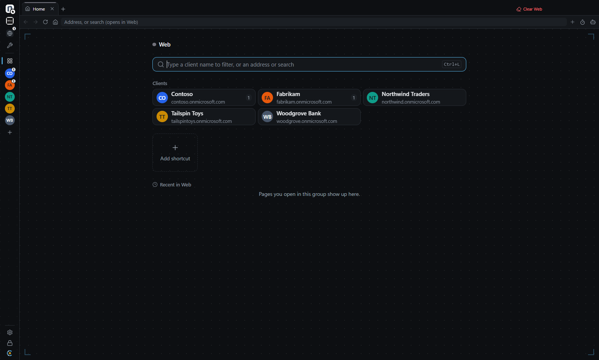<br><b>Home: all clients</b></td>
    <td width="50%">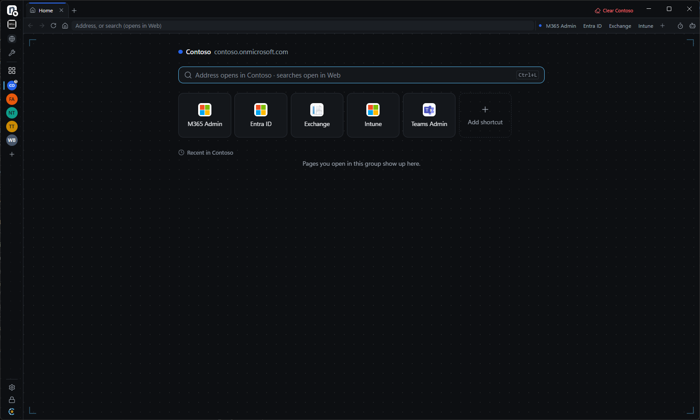<br><b>Client Home</b> with portal shortcuts</td>
  </tr>
  <tr>
    <td>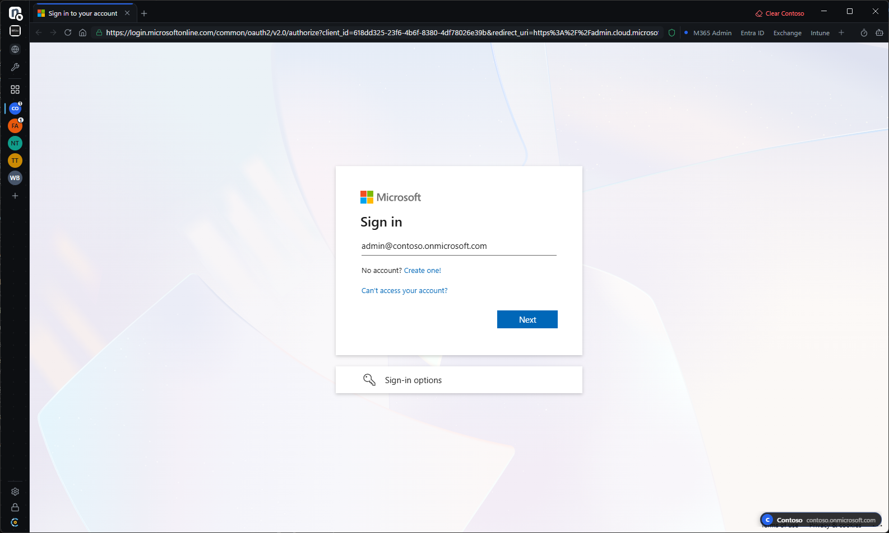<br><b>Client badge</b> on every page, sign-in name pre-filled</td>
    <td>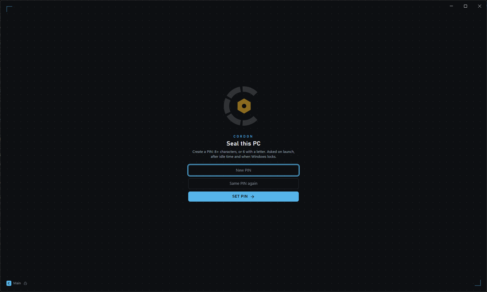<br><b>PIN lock</b> on launch, idle and Windows lock</td>
  </tr>
  <tr>
    <td>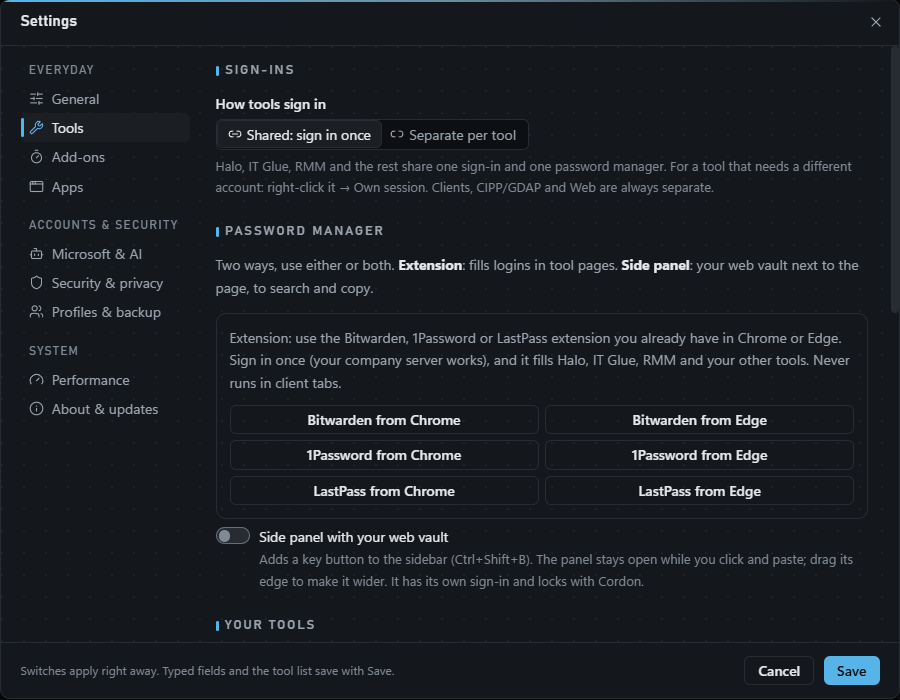<br><b>Settings → Tools:</b> sign-ins and password manager</td>
    <td>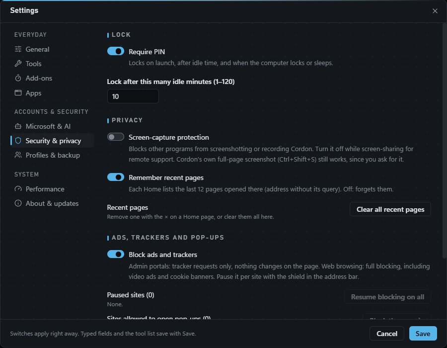<br><b>Settings → Security &amp; privacy</b></td>
  </tr>
  <tr>
    <td>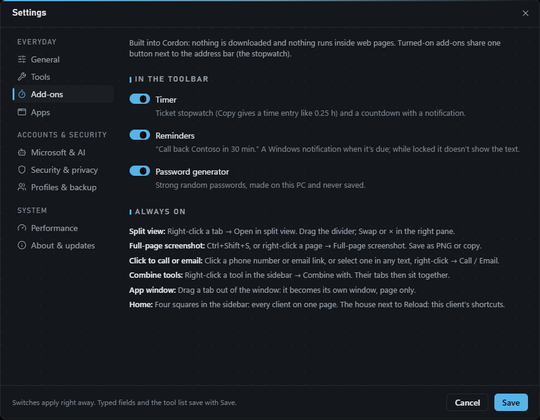<br><b>Settings → Add-ons</b></td>
    <td>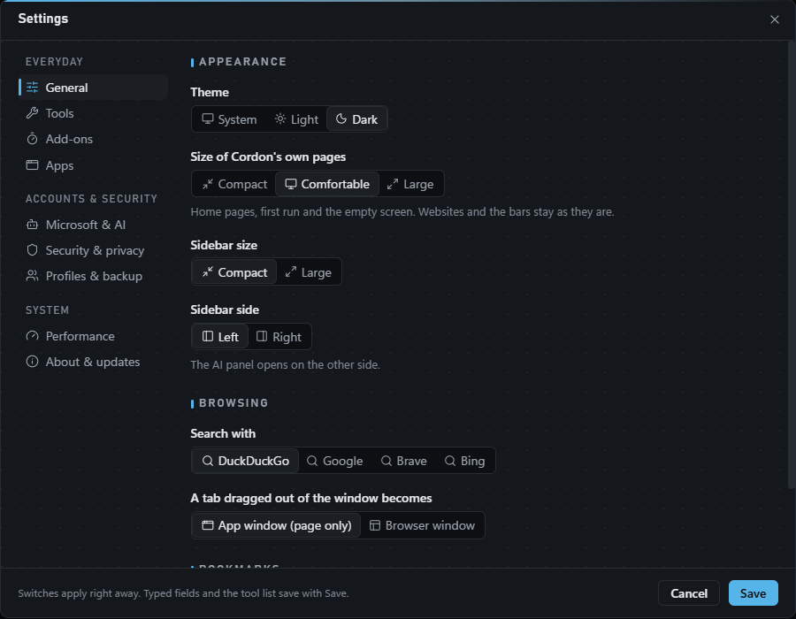<br><b>Settings → General</b></td>
  </tr>
  <tr>
    <td>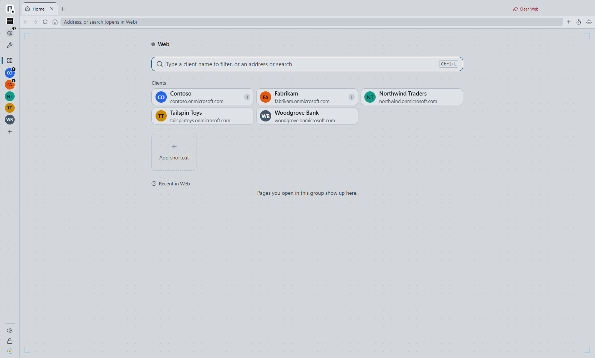<br><b>Light theme</b></td>
    <td>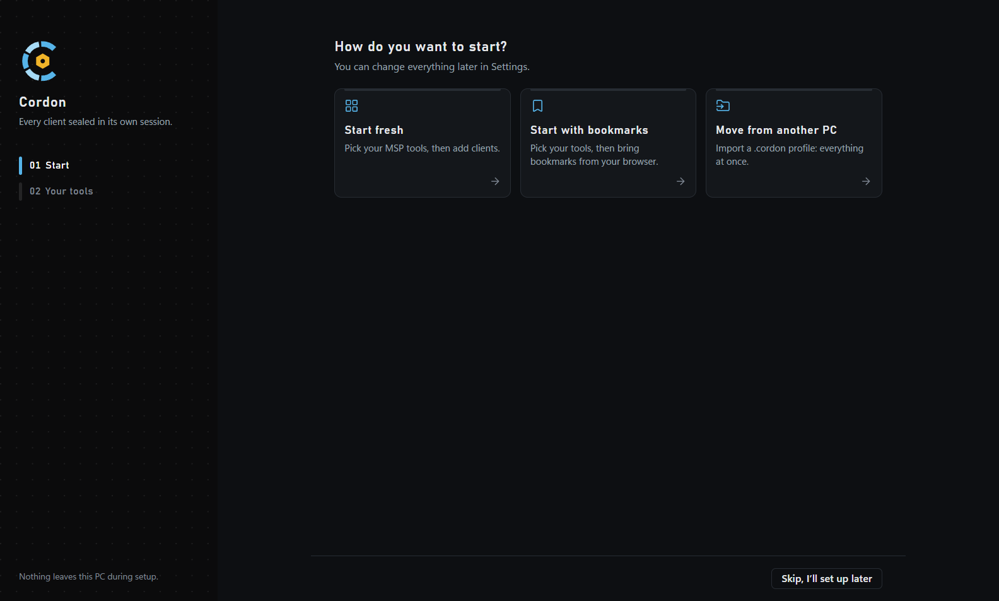<br><b>First run:</b> start fresh, import bookmarks or move from another PC</td>
  </tr>
</table>

## Install

**Windows 10 or 11.**

1. Open the **[latest release](https://github.com/d1same/cordon/releases/latest)** and download **`Cordon-Setup-x.y.z.exe`**.
2. Run it. The first time, Windows may show **"Windows protected your PC"**. Click **More info → Run anyway**. Cordon isn't signed with a paid Microsoft certificate; its updates are protected by Cordon's own signature ([how](#how-updates-are-protected)).
3. Pick **Only for me** (recommended) and finish.
4. On first launch, create your **PIN** (8+ characters, or 6 with a letter). Then start fresh, import your bookmarks, or import a profile from another PC.

**Updating:** nothing to do. Cordon checks every few hours and installs updates when you close it, or when you click **Relaunch** on the update banner.

**Uninstalling:** Windows Settings → Apps → Cordon → Uninstall. This also erases all saved sign-ins on that PC.

## How-to

<details open>
<summary><b>Add a client</b></summary>
<br>
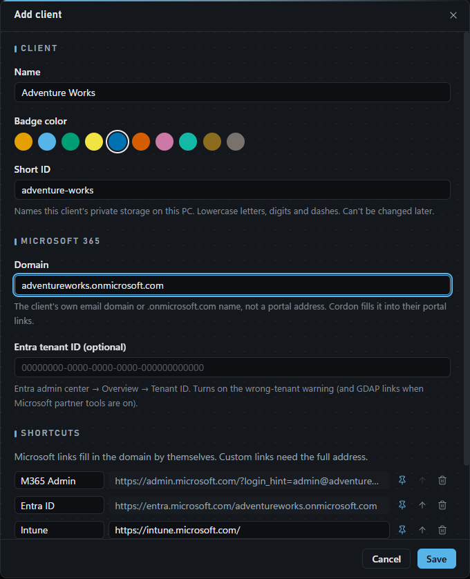

1. Click **+** (Add client) under the clients in the sidebar.
2. Type the **Name**. The short ID fills itself in.
3. Enter the client's **Domain** (e.g. `contoso.onmicrosoft.com`).
4. Optional: paste the **Entra tenant ID** to turn on the red wrong-tenant warning.
5. Add the portals they use under **Shortcuts**, pick a **Badge color**, then **Save**.
</details>

<details>
<summary><b>Use Home</b></summary>

1. Click the **four-squares** button in the sidebar to see every client.
2. Click a client, or type part of its name and press <kbd>Enter</kbd>.
3. In a client, click the **house** button (next to Reload) to get back to its shortcuts and recent pages.
4. Click **Add shortcut** to add a portal. Hover a recent page and click **×** to forget it.
</details>

<details>
<summary><b>Open split view</b></summary>

1. Open both tabs (they can be from different clients or tools).
2. Right-click the tab you want on the right → **Open in split view**.
3. Click the other tab: it fills the left side.
4. Drag the divider to resize. **Swap** switches sides; **×** closes the split and keeps the tab open.
</details>

<details>
<summary><b>Set up your password manager</b></summary>

**Extension (fills logins in tool pages):**
1. Install Bitwarden, 1Password or LastPass in Chrome or Edge, if you haven't already.
2. In Cordon, open **Settings → Tools → Password manager**.
3. Click, for example, **Bitwarden from Chrome**. Cordon loads its own copy.
4. Open any tool and sign into the extension once (SSO and self-hosted servers work).

**Side panel (your web vault next to the page):**
1. **Settings → Tools →** turn on **Side panel with your web vault**.
2. Pick Bitwarden, Bitwarden EU, 1Password or LastPass, or paste your company's vault address.
3. Press <kbd>Ctrl</kbd>+<kbd>Shift</kbd>+<kbd>B</kbd> and sign in once.
</details>

<details>
<summary><b>Turn on add-ons</b></summary>

1. Open **Settings → Add-ons**.
2. Switch on **Timer**, **Reminders** and/or **Password generator**.
3. Click the **stopwatch** button next to the address bar to use them.
</details>

<details>
<summary><b>Set up click-to-call</b></summary>

1. In Windows, open **Settings → Apps → Default apps**.
2. Search for **TEL** and pick your calling app (Teams, Zoom, your softphone…). Do the same for **MAILTO** if you want a specific mail app.
3. In Cordon, click a phone link and confirm with **Call**. Or select a number on any page, right-click → **Call …**.
</details>

<details>
<summary><b>Combine tools</b></summary>

1. Right-click a tool in the sidebar (or in **All tools**, the wrench).
2. Choose **Combine with** → pick the second tool. Repeat for up to 4 tools.
3. Click the combined button: the tools' tabs share one tab row, each tool keeps its own session.
4. To undo: right-click a tool → **Take … out of the combined button**, or **Uncombine all**.
</details>

<details>
<summary><b>Install a site as an app</b></summary>

1. Drag a tab out of the window, or right-click a tool, shortcut or tab → **Open as app window**.
2. To keep it: **Settings → Apps → Install as app**. It gets a Start Menu entry you can pin to the taskbar.
3. The app shares the sign-in of its tool or client. Move the mouse to its top edge for back, reload and copy-address buttons.
</details>

<details>
<summary><b>Move to another PC</b></summary>

1. **Settings → Profiles & backup → Export profile…**, and choose a password.
2. On the new PC, pick **Move from another PC** on first launch (or **Import** in the same place).
3. Clients, tools, settings, bookmarks and apps come along. Sign-ins and the PIN never leave the device.
</details>

### Keyboard shortcuts

| Shortcut | Action |
|---|---|
| <kbd>Ctrl</kbd>+<kbd>K</kbd> | Find a client, tool, tab or shortcut |
| <kbd>Ctrl</kbd>+<kbd>L</kbd> | Address bar |
| <kbd>Ctrl</kbd>+<kbd>T</kbd> / <kbd>Ctrl</kbd>+<kbd>W</kbd> | New tab / close tab |
| <kbd>Ctrl</kbd>+<kbd>Shift</kbd>+<kbd>T</kbd> | Reopen closed tab |
| <kbd>Ctrl</kbd>+<kbd>Shift</kbd>+<kbd>N</kbd> | New window |
| <kbd>Ctrl</kbd>+<kbd>B</kbd> | Expand or collapse the sidebar |
| <kbd>Ctrl</kbd>+<kbd>Shift</kbd>+<kbd>B</kbd> | Password vault panel |
| <kbd>Ctrl</kbd>+<kbd>Shift</kbd>+<kbd>S</kbd> | Full-page screenshot |
| <kbd>Ctrl</kbd>+<kbd>Shift</kbd>+<kbd>L</kbd> | Lock now |

## Security

- **Sandboxed.** Every page runs in Chromium's sandbox. Websites get no access to your files or to Cordon itself.
- **https only.** Certificate errors are never bypassed.
- **No silent permissions.** Camera, microphone, location, notifications and USB/Bluetooth are blocked for websites. Downloads need your approval every time.
- **Encrypted at rest.** Saved sign-ins are encrypted with your Windows account.
- **Locked down at launch.** Cordon refuses to start with debugging, proxy or certificate-bypass flags that could expose sessions, even from an edited shortcut.
- **Screen-capture protection** (optional) hides Cordon from screenshots and recordings by other programs.
- **Tested every release.** Each release passes automated attack tests on the packaged app before it's signed.

### How updates are protected

Every installer is signed with an offline key that never touches GitHub. Before installing anything, Cordon checks that:

1. the signature matches the key built into the app,
2. the version is the one announced (an old installer can't be re-sent as a new one),
3. the downloaded file is byte-for-byte the one that was signed.

If any check fails, the update is deleted and not installed. Even someone who took over this GitHub repository couldn't push an update to your PCs.

Release signing key fingerprint: `f985ce6f6a50a969`

<details>
<summary><b>Check a download yourself (optional)</b></summary>

In PowerShell, in the folder with the installer:

```powershell
$f = Get-Item ".\Cordon-Setup-*.exe"
[Convert]::ToBase64String([Security.Cryptography.SHA512]::Create().ComputeHash([IO.File]::ReadAllBytes($f.FullName)))
```

The output must equal the `sha512:` line in that release's `latest.yml`.
</details>

### Files in each release

| File | What it is |
|---|---|
| `Cordon-Setup-x.y.z.exe` | The installer: the only file you need |
| `cordon-update.sig.json` | Cordon's signature for this installer (used by the built-in updater) |
| `latest.yml`, `*.blockmap` | Update feed files read by the app |
| `cordon-policy.json` + `.sig` | Only on critical security releases: tells older versions to update |

## FAQ

**Is it free?** Yes.

**Mac?** Not yet. Windows first.

**Does Cordon see my passwords or client data?** No. Everything stays on your PC. Cordon has no account, no cloud and no telemetry.

**Found a bug or have an idea?** [Open an issue](https://github.com/d1same/cordon/issues/new/choose): pick *Report a problem* or *Suggest an improvement*, and include your Cordon version (Settings → About & updates). Issues are public, so leave out passwords and client names.

**Found a security problem?** Please report it privately: [Report a vulnerability](https://github.com/d1same/cordon/security/advisories/new). See [SECURITY.md](SECURITY.md).
