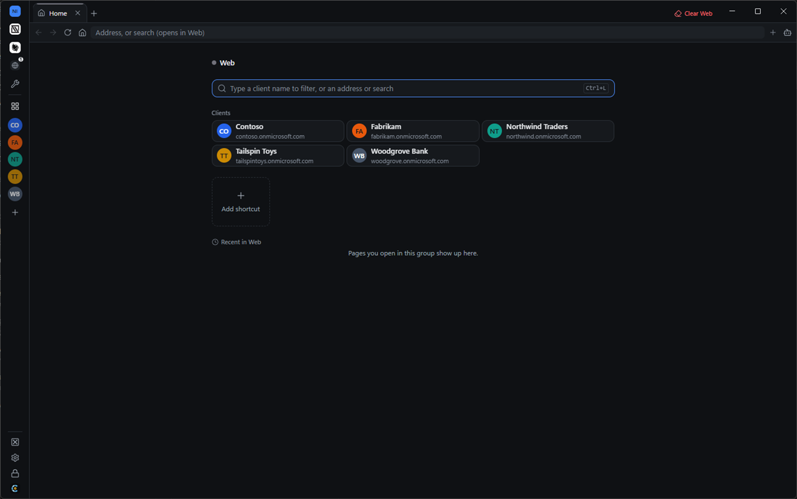
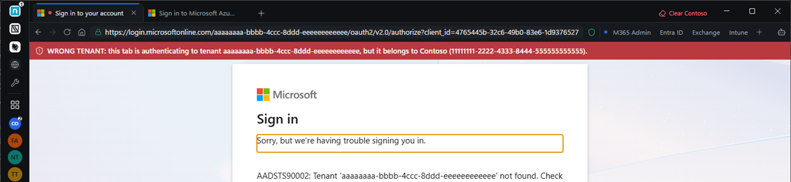
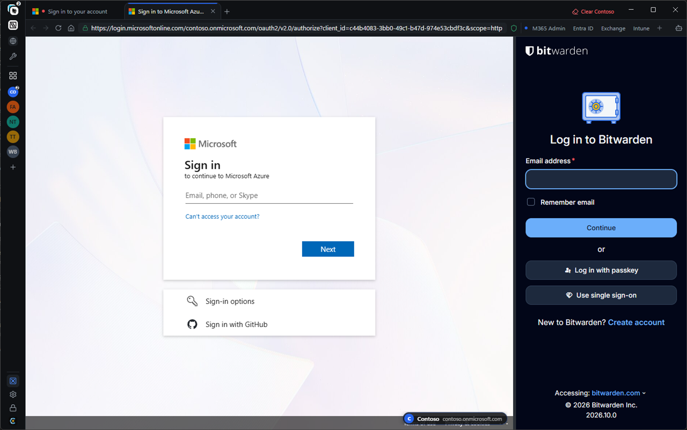
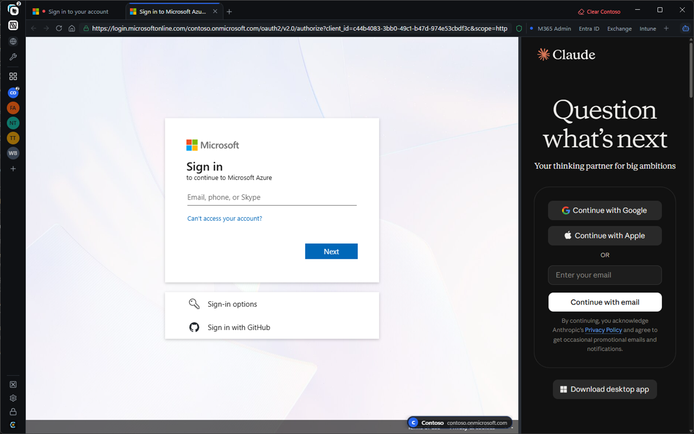
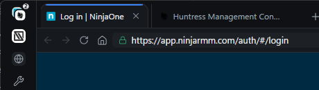

<p align="center">
  
</p>

<h1 align="center">Cordon</h1>

<p align="center">
  <b>One browser for every client. Nothing crosses between them.</b><br>
  A secure, multi-tenant browser for MSP technicians.
</p>

<p align="center">
  <a href="https://github.com/d1same/cordon/releases/latest"><b>⬇ Download the latest version</b></a>
  &nbsp;·&nbsp; <a href="#install-windows-1011">Install</a>
  &nbsp;·&nbsp; <a href="#features">Features</a>
  &nbsp;·&nbsp; <a href="#how-to">How-to guides</a>
</p>

<p align="center">
  
</p>

<p align="center"><sub>All screenshots use made-up sample clients (Contoso, Fabrikam, Northwind…).</sub></p>

---

## Features

### Client isolation
- **Every client in its own sealed session.** Be signed into Contoso's and Fabrikam's Microsoft 365, Google and Adobe admin portals at the same time. Cookies and sign-ins never mix.
- **Client badge on every page.** A colored frame and a name + domain badge show whose tenant you're in, even in screen shares.
- **Wrong-tenant warning.** A red bar when a client's tab signs into a different Microsoft tenant, an amber bar when the sign-in name or domain doesn't match. (Add the client's tenant ID for the red check.)
- **Clear one client** or **wipe everything** in one click.

### Finding your way
- **Home: all clients.** The four-squares button in the sidebar opens a page with every client. Type to filter, or type an address or search.
- **Client Home.** The house button opens the current client's Home: their portal shortcuts (M365 Admin, Entra ID, Intune…) and recent pages.
- **Quick switcher.** Ctrl+K finds any client, tool, open tab or client shortcut.
- **Reopen closed tab.** Ctrl+Shift+T, or right-click a tab.

### Working side by side
- **Split view.** Two tabs next to each other, for example a client's Entra next to your RMM. Drag the divider to resize, swap sides with one click.
- **Combined tools.** Put 2–4 tools (say NinjaOne + Huntress) behind one sidebar button. Their tabs share the tab row; each tool keeps its own session.
- **Multiple windows.** Drag a tab or a whole client out into its own window.

### Your MSP tools
- Halo, ConnectWise, Autotask, IT Glue, Hudu, N-sight, N-central, NinjaOne, Datto RMM, Huntress, Duo, SentinelOne, Cove, CIPP, or any https tool you add.
- **Tool sign-ins: shared or separate.** *Shared* signs you in once for all everyday tools (one Microsoft sign-in, one password manager). *Separate* gives every tool its own session. One tool can always have its own session (right-click it → **Own session**).
- **Install a site as an app.** Any tool or client shortcut can run in its own window with its own taskbar icon and Start Menu entry, sharing the same sign-in.

### Side panels
- **Password manager panel.** Your Bitwarden web vault (cloud, EU or your company's own server) or 1Password, beside the page. Open it with Ctrl+Shift+B. It locks when Cordon locks.
- **AI side panel.** Microsoft 365 Copilot, ChatGPT, Claude or Gemini (or any https address), with its own sign-in, separate from every client.

### Everyday browsing
- **Click to call and email.** Phone and email links open your calling app (Teams, Zoom…) or mail app. Select a phone number or email address on any page, right-click → **Call …** / **Email …**. When a page itself starts a call, Cordon asks first.
- **Search engine of your choice:** DuckDuckGo (default), Google, Brave or Bing. Searches always open in the separate **Web** group, never inside a client's session.
- **Ad and tracker blocking** in every session. Pause it for one site with the shield button in the address bar.
- **Tab sleeping.** Background tabs you haven't used for a while sleep to save memory and wake when clicked. **Lean mode** for low-memory PCs.

### Security and setup
- **PIN lock.** Locks on launch, after idle time, and when your PC locks or sleeps. Ctrl+Shift+L locks now.
- **Profile export / import.** Move your clients, tools, settings, bookmarks and apps to another PC in a password-protected file. Sign-ins and the PIN never leave the device.
- **Signed automatic updates.** Every update is checked against Cordon's own signature before it installs ([details below](#how-updates-are-protected)).
- **Bookmark import** from Chrome, Edge, Brave, Firefox and others, sorted into the right client.

## Screenshots

| | |
|---|---|
| <br><b>Home: all clients</b> (four-squares button) | <br><b>Client Home</b> with shortcuts (house button) |
| <br><b>Client badge</b> on every page | <br><b>Wrong-tenant warning</b> |
| <br><b>Password manager panel</b> | <br><b>AI side panel</b> |
| <br><b>Settings → General</b> | <br><b>Settings → Tools</b> |

## Install (Windows 10/11)

1. Open the **[latest release](https://github.com/d1same/cordon/releases/latest)** and download **`Cordon Setup x.y.z.exe`**.
2. Run it. Windows may show **"Windows protected your PC"** the first time. Click **More info → Run anyway**. (Cordon isn't signed with a paid Microsoft certificate. Updates are protected by Cordon's own signature, below.)
3. Pick **Only for me** (recommended) and finish.
4. On first launch, create your **PIN** (8+ characters, or 6 with a letter). Then import a profile or bookmarks, or start fresh.

**Updating:** nothing to do. Cordon checks every few hours and installs updates when you close it, or when you click **Relaunch** on the update banner.

**Uninstalling:** Windows Settings → Apps → Cordon → Uninstall. This also erases all saved sign-ins on that PC.

## How-to

### Add a client


1. Click **+** (Add client) under the clients in the sidebar.
2. Type the **Client name**. The client ID fills itself in.
3. Enter the client's **Microsoft 365 domain** (e.g. `contoso.onmicrosoft.com`).
4. Optional: paste the **Entra tenant ID** to turn on the red wrong-tenant warning.
5. Click the portals they use under **Shortcuts** (M365 Admin, Entra ID, Google Admin…), pick a **Badge color**, then **Save**.

### Use Home
1. Click the **four-squares** button in the sidebar to see every client.
2. Click a client, or type part of its name and press Enter.
3. In a client, click the **house** button (next to Reload) to get back to that client's shortcuts and recent pages.
4. Click **Add shortcut** to add a portal. Drag tiles to reorder them.

### Open split view
1. Open both tabs you want to see (they can be from different clients or tools).
2. Right-click the tab you want on the right → **Open in split view**.
3. Click the other tab: it fills the left side.
4. Drag the divider to resize (double-click to make both sides equal). **Swap** switches sides, **✕** closes the split; the tab stays open.

### Combine tools


1. Right-click a tool in the sidebar (or in **All tools**, the wrench).
2. Choose **Combine with** → pick the second tool. Repeat for up to 4 tools.
3. Click the combined button: both tools' tabs show in one tab row.
4. To undo: right-click a tool → **Take … out of the combined button**, or **Uncombine all**.

### Set up the password panel (company Bitwarden server)
1. Open **Settings** (gear in the sidebar) → **General** → **Password manager panel**.
2. Paste your server's address in **Vault address**, e.g. `https://vault.yourcompany.com`. (Or click **Bitwarden**, **Bitwarden EU** or **1Password**.)
3. Click **Save**.
4. Press **Ctrl+Shift+B** (or click the Passwords button in the sidebar) and sign in once. The panel stays open while you copy and paste, and locks when Cordon locks.

### Set up click-to-call
1. In Windows, open **Settings → Apps → Default apps**.
2. Search for **TEL**, and pick your calling app (Teams, Zoom, your softphone…). Do the same for **MAILTO** if you want a specific mail app.
3. In Cordon, select a phone number on any page and right-click → **Call …**. It opens your calling app right away.
4. Clicking a phone link on a page asks first: click **Call** to confirm.

### Install a site as an app
1. Right-click a tool, a client shortcut or a tab → **Open as app window**.
2. To keep it: **Settings → Apps → Install as app** → **Install**. It gets a Start Menu entry (under Cordon Apps) you can pin to the taskbar.
3. Optional: tick **Always** so clicking that tool in the sidebar opens the app window instead of a tab.
4. The app shares the sign-in of its tool or client. Move the mouse to the top edge for back, reload and copy-address buttons.

## Files in each release

| File | What it is |
|---|---|
| `Cordon Setup x.y.z.exe` | The installer, the only file you need |
| `cordon-update.sig.json` | Cordon's signature for this installer (used by the built-in updater) |
| `latest.yml`, `*.blockmap` | Update feed files read by the app |
| `cordon-policy.json` + `.sig` | Only on critical security releases: tells older versions to update |

## How updates are protected

Every installer is signed with an offline key that never touches GitHub. Before installing anything, Cordon checks that:

1. the signature matches the key built into the app,
2. the version is the one announced (an old installer can't be re-sent as a new one),
3. the downloaded file is byte-for-byte the one that was signed.

If any check fails, the update is deleted and not installed. Even someone who took over this GitHub repository couldn't push an update to your PCs.

Release signing key fingerprint: `f985ce6f6a50a969`

<details>
<summary><b>Check a download yourself (optional)</b></summary>

In PowerShell, in the folder with the installer:

```powershell
$f = Get-Item ".\Cordon Setup *.exe"
[Convert]::ToBase64String([Security.Cryptography.SHA512]::Create().ComputeHash([IO.File]::ReadAllBytes($f.FullName)))
```

The output must equal the `sha512:` line in that release's `latest.yml`.
</details>

## Security at a glance

- Every page runs in Chromium's sandbox; websites get no access to your files or to Cordon itself.
- https only; certificate errors are never bypassed.
- Camera, microphone, location, notifications and USB/Bluetooth are blocked for websites.
- Downloads need your approval every time.
- Saved sign-ins are encrypted with your Windows account.
- Cordon refuses to start with debugging or proxy flags that could expose sessions.

## FAQ

**Mac?** Not yet; Windows first.

**Found a bug or have an idea?** [Open an issue](https://github.com/d1same/cordon/issues/new/choose). It takes a minute: pick *Report a problem* or *Suggest an improvement*, and include your Cordon version (Settings → About). Issues are public, so leave out passwords and client names.

**Found a security problem?** Please report it privately: [Report a vulnerability](https://github.com/d1same/cordon/security/advisories/new). See [SECURITY.md](SECURITY.md).
